# Strata Multiview

**Multiviewer broadcast logiciel pour la régie de diffusion.** Strata Multiview compose des mosaïques de sources vidéo (multiviews) dans le navigateur : les images des entrées en direct avec leur **tally**, leur **UMD**, leurs **vu-mètres**, leur **loudness EBU R128** et leur **timecode**, les **alarmes** (perte, noir, image figée, silence, niveau), l'état **PTP / NTP**, le journal des défauts, des horloges et des logos. Il envoie le résultat vers les sorties du studio : HTML5, NDI, flux SRT / RTMP / HLS, SDI (DeckLink) et SMPTE ST 2110.

Un seul exécutable par plateforme, un moteur de rendu en Rust, une interface web.

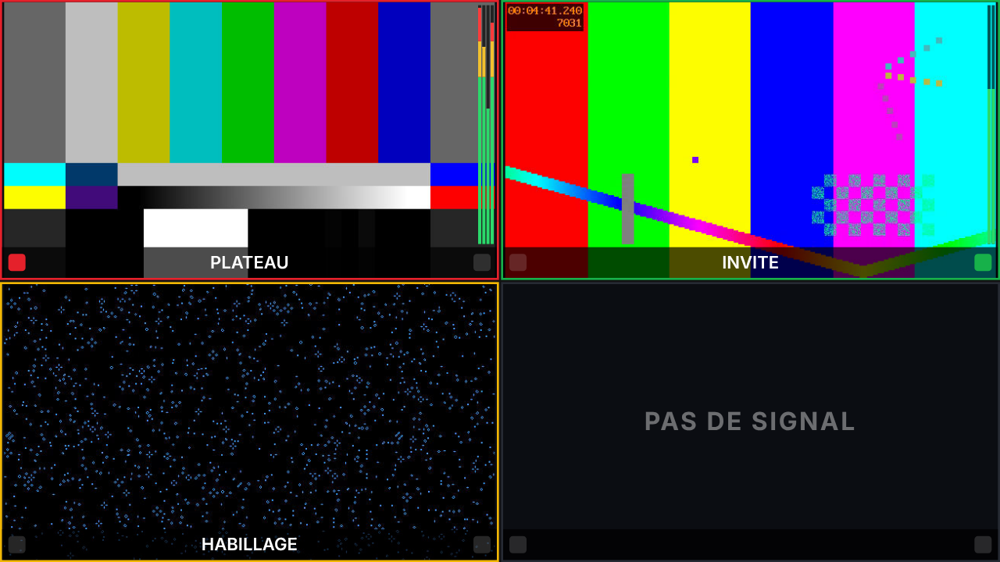

## Sommaire

1. [Vue d'ensemble](#1-vue-densemble)
2. [Installation](#2-installation)
3. [Premiers pas](#3-premiers-pas)
4. [Designer](#4-designer)
5. [La tuile Source](#5-la-tuile-source)
6. [Tally et UMD](#6-tally-et-umd)
7. [Audio, loudness et alarmes](#7-audio-loudness-et-alarmes)
8. [Diffusion](#8-diffusion)
9. [Système](#9-système)
10. [API](#10-api)
11. [Développement](#11-développement)
12. [Documentation complémentaire](#12-documentation-complémentaire)

---

## 1. Vue d'ensemble

### 1.1 La chaîne

```
 Entrées en direct ──► image, audio (niveaux, loudness R128), timecode, alarmes
 (SRT, UDP, RTMP, HLS, RTSP, NDI, SDI)        │
                                               ▼
 Régie (TSL 3.1 / 5.0, ATEM, GPI, API) ──► tally et UMD de chaque entrée
                                               │
                                               ▼
 Designer ──► multiviews publiés ──► chaîne ──► sorties (HTML5 · NDI · Stream · SDI · ST 2110)
```

- Les **entrées en direct** sont décodées en continu, et **analysées** : conteneur, programmes et EPG, codecs, images, timecode, sous-titres codés, tables MPEG-TS et TR 101 290, listes HLS, ANC SDI ; leur audio est mesuré canal par canal et en loudness EBU R128 ; leur image est surveillée (noir, image figée) ; une entrée qui tombe lève une alarme.
- Le **tally** et les **UMD** viennent des mélangeurs et des contrôleurs de tally, aiguillés vers les entrées.
- Le **Designer** compose les multiviews : vide, sur une **disposition** (2 × 2, 3 × 3, 1 + 5…) de **tuiles Source**, ou à partir d'un des **vingt exemples** (régie finale, scopes et HDR, son 5.1 et Dante, SRT, PTP / ST 2110, UHD, mur de deux écrans, écran vertical…) — le tout depuis un seul bouton **+ Nouveau multiview**, qui accepte aussi un fichier `.json` déposé pour l'importer —, puis les widgets de supervision (vu-mètres 16 canaux, loudness, timecode, état, journal des alarmes), des horloges, des logos et des textes.
- Une **chaîne** montre un multiview publié et l'envoie vers ses destinations.

### 1.2 Les pages

| Menu | Page | Rôle |
| --- | --- | --- |
| **Multiviews** | accueil | les multiviews (un par régie ou par mur d'écrans), leurs dossiers, l'import et l'export |
| **Bibliothèque** | médias partagés | images, vidéos, sons et polices communs à tous les multiviews (logos, fonds) |
| **Diffusion** | Flux vidéo · Entrées vidéo · Tally et UMD | chaînes et destinations ; entrées en direct ; sources de tally et aiguillage |
| **Système** | Matériel · Performances · Santé · Utilisateurs · API · Paramètres | cartes SDI, ST 2110, synchro ; supervision ; comptes et droits ; clés d'API ; réglages du serveur |

Un multiview s'ouvre directement dans le **Designer**, dans son propre onglet.

### 1.3 Les rôles

| Rôle | Peut |
| --- | --- |
| **Admin** | tout : utilisateurs, chaînes, entrées, tally, réglages du serveur |
| **Designer** | créer et modifier les multiviews, en mettre un à l'antenne d'une chaîne |
| **Operator** | choisir le multiview à l'antenne d'une chaîne ; régler le tally par l'API |
| **Viewer** | consulter les multiviews et les sorties |

L'interface est en **français ou en anglais**, au choix de chaque utilisateur. Les textes que le multiview écrit lui-même (« PAS DE SIGNAL », « IMAGE FIGÉE ») suivent la langue du multiview.

---

## 2. Installation

Le serveur est **un exécutable autonome** par plateforme : il embarque l'interface web, les polices et le moteur. Il s'installe en service natif.

| Plateforme | Paquet | Service |
| --- | --- | --- |
| **Windows** | installateur `.msi` avec l'app Strata Multiview (zone de notification) ; déploiement silencieux `msiexec /qn` | service Windows `strata-multiview` |
| **macOS** | installateur `.pkg` universel (Apple Silicon + Intel) avec l'app Strata Multiview (barre des menus), livré en image disque | launchd `com.stratamultiview.server` |
| **Linux** | archive avec binaire et `sudo ./install.sh` | systemd `strata-multiview` |

Les commandes de service sont les mêmes partout :

```bash
strata-mv-server service install | uninstall | start | stop | status
```

**À côté d'autres logiciels** : rien n'est partagé. Le port par défaut est **8090**, le cookie de session `strata_mv_session`, les clés d'API commencent par `smv_`. Les dossiers aussi sont distincts : `/opt/strata-multiview`, `/var/lib/strata-multiview`, « Strata Multiview » sous Windows et macOS. Le service tourne sous son propre compte `strata-mv` et l'installateur Windows a son propre code de mise à niveau.

Les **mises à jour** se font depuis **Système › Paramètres › Mises à jour** : en ligne (releases GitHub de `DamienP2/Strata-Multiview`, paquets `StrataMV-<version>-<plateforme>`) ou en déposant l'archive pour un serveur hors ligne, avec retour automatique à la version précédente si la nouvelle ne démarre pas.

ffmpeg est nécessaire aux entrées en flux (et à leur audio), aux sorties Stream et à la conversion des vidéos : les installateurs l'embarquent. Le runtime NDI est livré avec les installateurs macOS et Windows ; sous Linux, installez-le ou indiquez son chemin.

Guide complet, dossiers de données, pare-feu, proxy : [`docs/INSTALL.md`](docs/INSTALL.md).

---

## 3. Premiers pas

1. Ouvrez `http://<serveur>:8090`. Sur le serveur lui-même, la page propose de **créer le compte administrateur** ; à distance, utilisez `strata-mv-server user add admin`.
2. **Diffusion › Entrées vidéo** : déclarez les sources (caméras en SDI, flux SRT d'un encodeur, sources NDI du réseau…).
3. **Multiviews › Nouveau multiview** : nommez-le, choisissez sa résolution, partez d'une page **vide** ou d'une **disposition** (2 × 2, 1 + 5, 4 × 4…) dont les tuiles reçoivent les entrées dans l'ordre. Le multiview s'ouvre dans le **Designer**. Pour partir d'un multiview complet, choisissez **Depuis un exemple** dans la même fenêtre ; pour importer, déposez-y le fichier `.json`.
4. Ajustez les tuiles (entrée, UMD, vu-mètres, timecode, loudness), ajoutez des widgets, un logo, un titre, puis **Publiez**.
5. **Diffusion › Flux vidéo** : choisissez le **multiview à l'antenne** de la chaîne : il passe aussitôt à l'antenne. Ajoutez les destinations (HTML5, NDI, SDI, ST 2110, flux).
6. **Diffusion › Tally et UMD** : ajoutez la régie (TSL, ATEM ou GPI) et reliez ses afficheurs aux entrées.

La sortie HTML5 de la chaîne principale est sur `http://<serveur>:8090/output/main`.

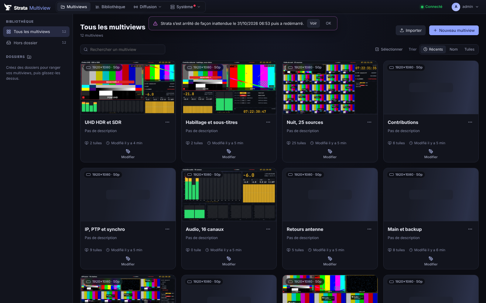

---

## 4. Designer

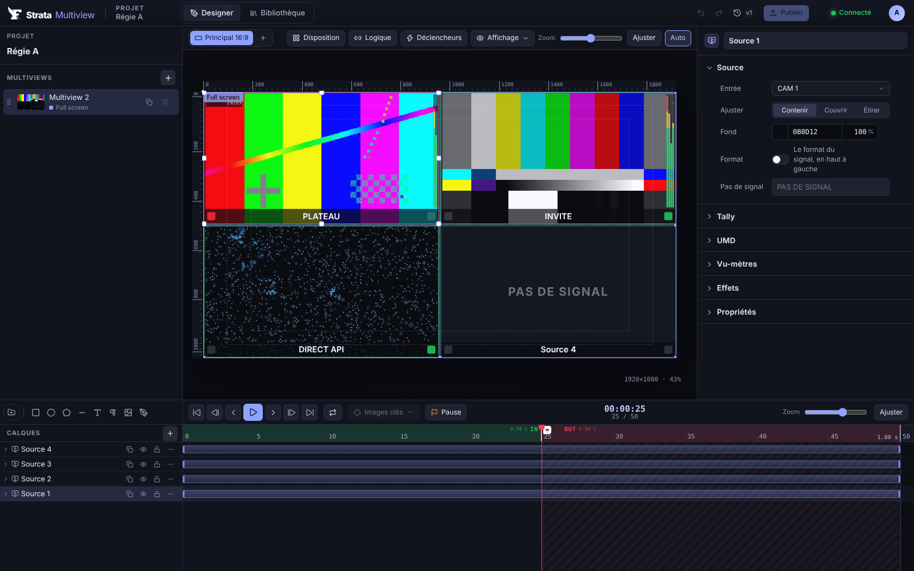

### 4.1 L'espace de travail

- **En haut** : le nom du multiview, annuler / rétablir, l'historique des versions et **Publier**.
- **Au centre** : la **scène** (règles, repères, zones de sécurité, fond) avec la barre d'outils : **Disposition**, **Source** (une tuile), les formes et les textes, **+** (vu-mètres, loudness, timecode, état, journal des alarmes, horloge, temps), les **outils de contrôle** (oscilloscope, parade, vectorscope, histogramme, CIE, fausses couleurs), **Affichage**, zoom. En haut, la **sortie** : le canal sur lequel le multiview s'affiche (ceux qui l'affichent, les libres, ceux qui en affichent un autre), et sa page web. Les tuiles y montrent les entrées en direct, leur tally et leurs vu-mètres. Un clic sélectionne, un glisser déplace ; clic droit : **Entrée** (sur une tuile, des vu-mètres, un loudness ou un timecode : l'entrée à montrer, celles qui reçoivent marquées d'un point vert), copier, couper, coller, dupliquer, ordre, supprimer.

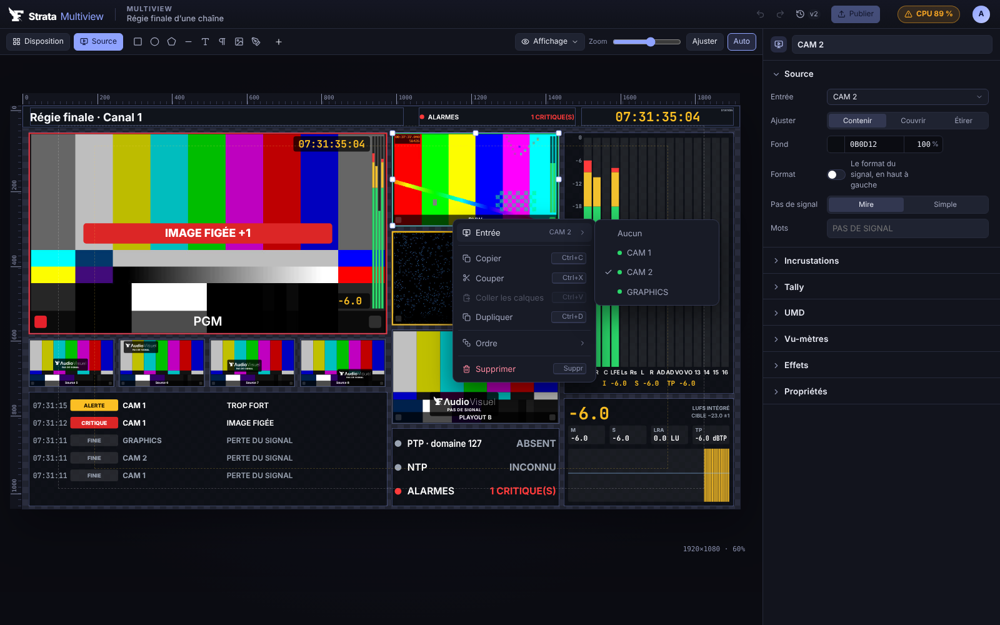
- **À droite** : l'inspecteur de l'élément sélectionné ; sans sélection, le multiview lui-même (résolution, ses tuiles, ses réglages).

Un multiview s'édite directement : une seule page, ni calques, ni timeline, ni animation. Ce qui bouge vient des sources (images, tally, vu-mètres, loudness, alarmes) et des widgets eux-mêmes (timecode, horloges).

### 4.2 Exemples

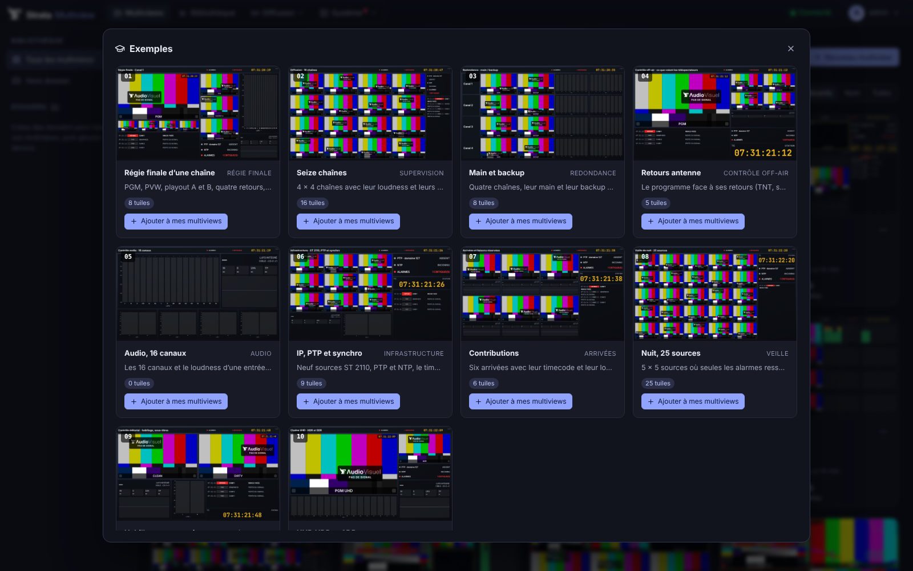

Le bouton **+ Nouveau multiview** (le seul de la page **Multiviews**) ouvre une fenêtre en deux colonnes : à gauche, **Vierge** (page vide ou disposition), **Depuis un exemple**, et une **zone de dépôt** où glisser un `.json` exporté de Strata Multiview pour l'importer (ou cliquer pour le choisir) ; à droite, le formulaire ou les exemples, deux par ligne, filtrables par catégorie. **Utiliser cet exemple** en fait une copie, dont les tuiles prennent les entrées du serveur dans l'ordre, et l'ouvre dans le Designer : tout y reste modifiable.

Les vingt exemples utilisent tous les outils : tuiles avec repères (zones de sécurité, 4:3 / 14:9, centre, AFD) et badge de secours, scopes (waveform, parades, vecteurscope, histogramme, CIE, fausses couleurs, goniomètre), fiches signal, courbes (PTP, NTP, CPU, mémoire, rendu, images par seconde, loudness, RTT et pertes SRT) et valeurs.

| N° | Exemple | Catégorie | Contenu |
| --- | --- | --- | --- |
| 01 | **Régie finale d’une chaîne** | Régie finale | PGM avec zones de sécurité, PVW, deux playouts, quatre retours, 16 canaux, loudness et fiche signal. |
| 02 | **Mur de 16 sources** | Mosaïque | Seize sources en 4 × 4 avec UMD, vu-mètres et alarmes, et une barre d’état de l’installation. |
| 03 | **Contrôle image et colorimétrie** | Vision | Une source en grand et ses six outils de mesure : waveform, parades, vecteurscope, histogramme, CIE. |
| 04 | **Contrôle HDR / SDR** | Vision | Les versions HDR et SDR côte à côte, fausses couleurs, CIE, parade et métadonnées HDR. |
| 05 | **Console audio 5.1** | Son | 16 canaux, loudness R128, courbe du loudness court terme, goniomètre et toutes les valeurs. |
| 06 | **Supervision Dante / AES67** | Son | Quatre flux Dante / AES67 de 8 canaux : vu-mètres, goniomètres, loudness et alarmes. |
| 07 | **Contributions SRT** | Réseau | Six arrivées SRT avec leur RTT et leurs pertes en courbes, et le journal des alarmes. |
| 08 | **Redondance principal / secours** | Régie finale | Six chaînes en double, principal et secours côte à côte, avec la pire alarme de chacun. |
| 09 | **Synchro et infrastructure ST 2110** | Réseau | L’écart PTP et NTP en courbes, l’état de la synchro, quatre flux ST 2110 et leurs formats. |
| 10 | **Contrôle UHD 2160p** | Vision | Un multiview UHD : la source 4K en grand avec ses repères, waveform, vecteurscope et fiche signal. |
| 11 | **Régie de journal télévisé** | Production | Programme avec repères 4:3 et 14:9, préparation, duplex, plateau, sujets et retour antenne. |
| 12 | **Car régie sport** | Production | Programme et préparation, dix caméras, deux ralentis : une régie de match avec tally. |
| 13 | **Plateau et prompteur** | Production | Six caméras plateau avec tally et UMD en haut, prompteur, programme et retour antenne. |
| 14 | **Contrôle qualité (QC)** | Vision | Tout ce qu’on vérifie avant diffusion : image, waveform, histogramme, niveaux, loudness et fiche. |
| 15 | **Diffusion OTT et plateformes** | Réseau | Le programme et ses sorties en ligne (YouTube, Twitch, HLS, Facebook) avec leurs images par seconde. |
| 16 | **Tableau de bord du serveur** | Supervision | La santé de l’installation : processeurs, mémoire, décodeurs, rendu, alarmes et quatre sources. |
| 17 | **Radio filmée** | Son | Trois caméras de studio radio, le programme stéréo, son goniomètre, son loudness et ses crêtes. |
| 18 | **Mur de deux écrans** | Mosaïque | Un multiview de 3840 × 1080 découpé sur deux écrans : 20 sources et une barre d’état. |
| 19 | **Veille de nuit · 30 chaînes** | Supervision | 30 chaînes en petit pour la veille de nuit, alarmes visibles de loin, journal et état. |
| 20 | **Écran vertical réseaux sociaux** | Réseau | Un multiview vertical en 1080 × 1920 pour suivre les directs TikTok, Instagram et YouTube Shorts. |

Les exemples sont des fichiers `crates/strata-mv-server/examples/ex-NN-*.json` embarqués dans le serveur, écrits par `python3 scripts/gen-examples.py` (qui refuse un widget hors de l'image ou sur un autre) ; leurs tuiles lisent `{{input:N}}`, la N-ième entrée du serveur. La plupart sont en 1920 × 1080 à 50 i/s ; « Contrôle UHD » est en 3840 × 2160, « Mur de deux écrans » en 3840 × 1080 et « Écran vertical » en 1080 × 1920 à 30 i/s.

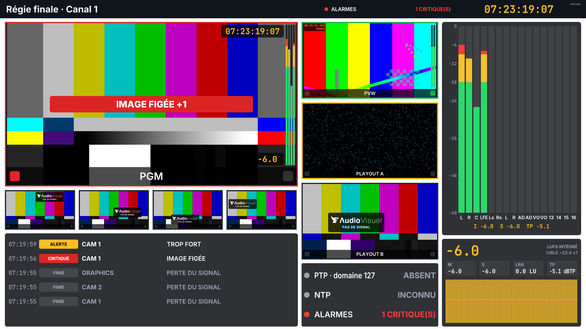

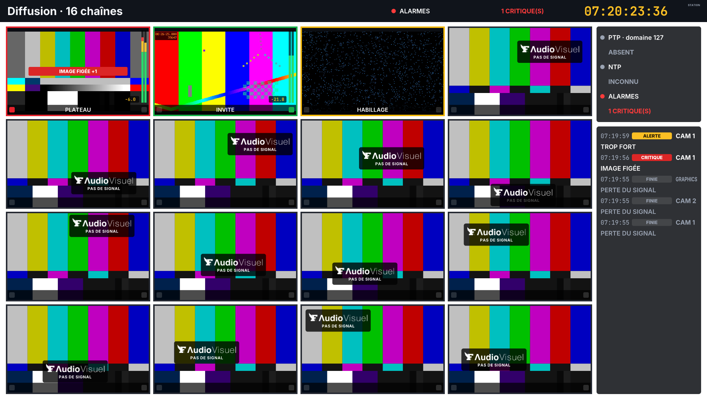

### 4.3 Dispositions

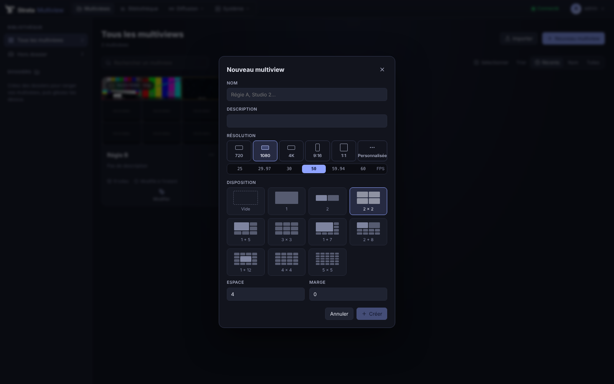

Une **disposition** place les tuiles Source sur une grille, avec un **espace** entre elles et une **marge** autour :

| Disposition | Tuiles |
| --- | --- |
| **1**, **2**, **2 × 2**, **3 × 3**, **4 × 4**, **5 × 5** | grilles régulières, tuiles en 16:9 |
| **1 + 5**, **1 + 7** | une grande tuile en haut à gauche, les autres autour |
| **2 + 8** | deux grandes en haut, huit petites en dessous |
| **1 + 12** | une grande au centre, douze autour |

Elle se choisit à la création d'un multiview (« Vide » par défaut), ou s'applique ensuite par le bouton **Disposition** : les tuiles existantes sont replacées dans l'ordre de lecture, les manquantes sont ajoutées avec les entrées qu'aucune tuile ne montre encore. Chaque tuile reste ensuite libre (position, taille, réglages).

### 4.4 Les widgets

L'inspecteur suit les mêmes règles pour tous les widgets : réglages marche / arrêt en **icônes** (leur nom en info-bulle), choix courts en **icônes** (ajustement, position, alignement, outil), nombres en **curseurs** avec leur champ, sections repliables (contenu, disposition, seuils, cadre, typographie).

Tous les widgets sont rendus à l'identique en HTML5 et par le moteur Rust (la géométrie est calculée dans `strata-mv-core`, chaque moteur ne fait que dessiner) :

| Pour | Widgets |
| --- | --- |
| **Audio** | **Vu-mètres** : jusqu'à 16 canaux d'une entrée, avec ou sans image ; noms des canaux (« L, R, C, LFE… »), échelle en dBFS, valeurs, crêtes, ligne de loudness |
| **Loudness** | **Loudness** EBU R128 d'une entrée : intégré en grand, momentary, short-term, LRA, true peak ; courbe short-term des deux dernières minutes ; couleurs selon la cible (−23 LUFS ± 1, true peak −1 dBTP) |
| **Temps** | **Timecode** : celui de la station (heure locale à la cadence de la chaîne) ou d'une entrée (NDI) ; Horloge (heure, date, fuseau, cadran analogique) ; Temps (chronomètre, compte à rebours) |
| **Supervision** | **État** : PTP (verrouillage, domaine, écart), NTP, alarmes en cours ; **Journal des alarmes** : les défauts des entrées, les plus récents d'abord, avec leur début et leur fin |
| **Contrôle de l'image** | **Scope** d'une entrée, au choix : **oscilloscope** (luminance), **parade RVB**, **parade Y'CbCr**, **vectorscope** (cibles 75 % et 100 %, ligne des tons chair), **histogramme** (luminance et R, V, B), **chromaticité CIE 1931** (gamuts BT.709, P3, BT.2020, point blanc D65), **fausses couleurs** (bandes d'exposition), **goniomètre** (gauche contre droite, gain automatique) avec **corrélation de phase** (−1 à +1, rouge hors phase) ; graticule selon le transfert du signal : % en SDR et HLG (blanc de référence 75 %), **nits en PQ / HDR10** (1 à 10 000, blanc de référence 203) |
| **Valeur** | **une variable en direct, seule, en texte** — à placer et styler librement : d'une entrée (nom, UMD, format, timecode, loudness M / S / I / LRA / TP, crêtes gauche / droite, codec, taille et échantillonnage, colorimétrie, SDR / HDR, niveaux R103, corrélation de phase, piste son, pire alarme, tally) ou de l'installation (heure, date, timecode station, état et écart PTP, écart NTP, processeurs, mémoire, alarmes en cours) ; libellé à côté, au-dessus ou masqué, seuils orange et rouge |
| **Tableau de bord** | **Courbe** : une mesure sur les dernières minutes (30 s à 5 min), en temps réel : **écart PTP** (lu chaque seconde), **écart NTP**, processeurs, mémoire, processeurs de Strata Multiview et des décodeurs, temps de rendu d'un canal, images par seconde ou loudness court terme d'une entrée ; valeur actuelle, échelle, seuils orange et rouge, minimum, moyenne et maximum. Plusieurs courbes font un tableau de bord dans un multiview |
| **Signal** | **Fiche signal** d'une entrée : codec et profil, taille, profondeur et échantillonnage (4:2:0, 4:2:2…), **colorimétrie** (matrice, primaires BT.709 / BT.2020 / P3), **transfert** (SDR, **PQ**, **HLG**), plage, badge **SDR / HDR10 / HLG / HDR10+ / Dolby Vision**, métadonnées **ST 2086** et **MaxCLL / MaxFALL**, **niveaux mesurés** (luminance mini et maxi en %, part de pixels hors normes, en orange hors EBU R103), pistes son avec marques **DOLBY** (Digital, Digital Plus, TrueHD, AC-4, E) et **ATMOS** |
| **Labels et logos** | Texte, Image (PNG, JPEG, SVG, GIF, vidéo en boucle) |
| **Formes** | rectangle, cercle, trait, dégradés |

La **publication** envoie les multiviews vers les sorties ; tant qu'un multiview n'est pas publié, les chaînes gardent la version précédente.

---

## 5. La tuile Source

Une tuile **Source** montre une entrée en direct et tout ce qu'elle porte :

| Élément | Réglages |
| --- | --- |
| **Image** | l'entrée ; ajustement *Contenir* (bandes noires), *Couvrir* ou *Étirer* ; couleur de fond |
| **Perte de signal** | *Mire* : barres SMPTE avec le logo **F AudioVisuel** et « PAS DE SIGNAL » qui rebondissent dessus (chaque tuile ailleurs) ; ou *Simple* : fond uni et texte modifiable |
| **Cadre de tally** | épaisseur ; couleurs *À l'antenne* (rouge), *Préparation* (vert), *Aux* (jaune), *Sans tally* ; le cadre peut ne pas suivre le tally |
| **UMD** | en bas, en haut ou sans ; sur l'image ou à côté ; hauteur ; texte (vide : celui de la régie, sinon le nom de l'entrée ; `{{clé}}` remplacées) ; police, alignement, couleurs ; **lampes** de tally aux deux bouts (antenne à gauche, préparation à droite) |
| **Vu-mètres** | à droite, à gauche ou sans ; un par canal reçu (ou au plus *n*) ; largeur, espace, marge ; échelle en dBFS, jaune et rouge à partir de seuils ; maintien des crêtes |
| **Format** | le format du signal (« 1080i50 ») en haut à gauche |
| **Timecode** | sans, celui de l'entrée ou celui de la station, en haut à droite |
| **Loudness** | le loudness short-term de l'entrée en bas à droite, coloré selon la cible |
| **Alarmes** | cadre rouge clignotant (critique) ou ambre (alerte) et bandeau du défaut (« IMAGE FIGÉE », « PERTE DU SIGNAL »…), avec le nombre d'autres défauts |

Les réglages et la géométrie sont communs aux deux moteurs (`strata-mv-core/src/wid/source.rs`, `web/src/widgets/source.tsx`) : la sortie HTML5 et les sorties du moteur Rust montrent la même image.

---

## 6. Tally et UMD

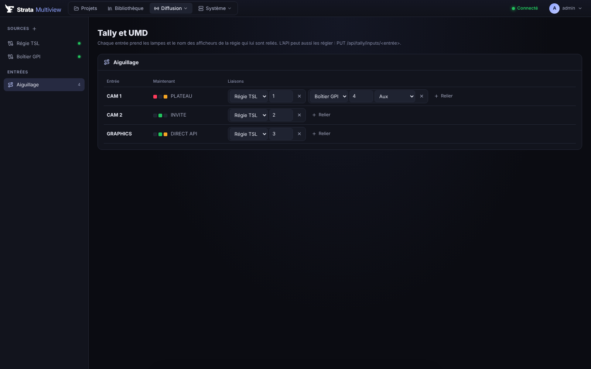

**Diffusion › Tally et UMD** réunit les sources de tally et l'aiguillage de leurs afficheurs vers les entrées. Les réglages sont dans `tally.json` du dossier de données et s'appliquent aussitôt, sans couper les sorties.

### 6.1 Les sources

| Source | Transport | Ce qui est lu |
| --- | --- | --- |
| **TSL UMD 3.1** | UDP, TCP (ce serveur écoute, ou se connecte au mélangeur) | adresse 0–126, tally 1 à 4 (chacun attribuable à l'antenne, la préparation ou l'aux), texte de 16 caractères |
| **TSL UMD 5.0** | UDP, TCP (trames DLE/STX) | index, tally gauche, droite et texte (rouge = antenne, vert = préparation, ambre = aux), texte ASCII ou UTF-16, filtre d'écran |
| **Blackmagic ATEM** | UDP 9910 vers l'adresse du mélangeur | tally de chaque entrée (numérotée comme sur le mélangeur) et son **nom long** comme texte d'UMD |
| **GPI** | un boîtier GPI qui appelle une URL | chaque contact allume la lampe choisie sur sa liaison |

Les mélangeurs Ross (Carbonite, Acuity), Grass Valley, Sony, Panasonic, vMix et la plupart des contrôleurs de tally parlent TSL : choisissez TSL 3.1 ou 5.0 selon leur réglage.

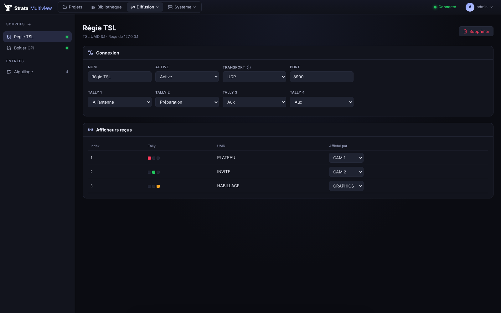

La page d'une source montre son état (« À l'écoute en UDP 8900 », « Reçu de 10.0.0.12 », « Connecté »…) et les **afficheurs reçus** avec leurs lampes et leur texte en direct ; chacun se relie d'un clic à une entrée.

### 6.2 L'aiguillage

Chaque entrée prend les lampes et le texte des afficheurs qui lui sont reliés : une source, un index (adresse TSL, numéro d'entrée ATEM, contact GPI) et, pour le GPI, la lampe à allumer. Plusieurs liaisons se cumulent (par exemple l'antenne d'un mélangeur et l'aux d'un contact GPI d'enregistreur). Le texte d'UMD est celui de la première liaison qui en a un.

### 6.3 GPI et API

Un boîtier GPI appelle, à la fermeture et à l'ouverture d'un contact :

```
GET http://<serveur>:8090/api/tally/gpi/<source>/<contact>/on?key=smv_…
GET http://<serveur>:8090/api/tally/gpi/<source>/<contact>/off?key=smv_…
```

L'automation peut aussi régler directement les lampes et l'UMD d'une entrée (les champs absents suivent l'aiguillage) :

```bash
curl -X PUT http://<serveur>:8090/api/tally/inputs/cam1 -H "Authorization: Bearer smv_…" \
  -H 'content-type: application/json' -d '{"program":true,"umd":"PLATEAU"}'
curl -X DELETE http://<serveur>:8090/api/tally/inputs/cam1 -H "Authorization: Bearer smv_…"
```

La clé d'API (Système › API) agit avec les droits de son utilisateur : un compte *Operator* suffit.

---

## 7. Audio, loudness et alarmes

### 7.1 Niveaux

L'audio de chaque entrée est mesuré à la réception, canal par canal : **crête** et **puissance moyenne** toutes les 40 ms environ. Les vu-mètres montent aussitôt, redescendent de 24 dB par seconde et gardent leur crête deux secondes.

| Entrée | Audio mesuré |
| --- | --- |
| **Flux** (SRT, UDP, RTMP, HLS, RTSP, URL) | la première piste audio, tous ses canaux (filtres `ebur128` et `astats` d'ffmpeg) ; une source sans audio est reconnue et décodée sans mesure |
| **NDI** | l'audio de la source, tous ses canaux |
| **SDI** (DeckLink) | l'audio embarqué : 16, 8 ou 2 canaux selon la carte, 48 kHz |

**Écouter un multiview** : sur la page web d'une sortie, un clic sur une tuile fait entendre le son de son entrée (encore un clic : silence) ; la barre d'écoute (source entendue, volume, liste des sources) n'apparaît que lorsque la souris bouge. Une sortie **NDI** peut aussi emporter le son d'une entrée avec l'image (Diffusion › sortie NDI › Son). Le serveur tient le son de chaque entrée en PCM 16 bits stéréo 48 kHz (`GET /api/inputs/{id}/audio`). Les tuiles Source montrent toujours leurs vu-mètres (au repos sans son).

Les niveaux arrivent au moteur et aux navigateurs (une douzaine de fois par seconde) avec le tally. Une entrée sans audio depuis trois secondes n'a plus de vu-mètres.

### 7.2 Loudness et timecode

Le **loudness EBU R128** de chaque entrée est mesuré en continu : momentary (400 ms), short-term (3 s), intégré, LRA et true peak. Les flux passent par le filtre `ebur128` d'ffmpeg, NDI et SDI par la même mesure en Rust. La cible est **−23 LUFS ± 1** et **−1 dBTP**. L'historique short-term (une valeur par seconde, deux minutes) nourrit la courbe du widget Loudness.

Le **timecode** d'une entrée est celui de NDI ; le **timecode station** est l'heure locale du serveur à la cadence de la chaîne.

### 7.3 Alarmes et journal

Chaque entrée et l'installation sont surveillées en permanence (**Diffusion › Alarmes**). Valeurs par défaut :

| Alarme | Gravité | Quand |
| --- | --- | --- |
| **Perte du signal** | critique | plus d'image reçue (pas pendant les 10 s où une entrée démarre) |
| **Noir** | critique | image noire depuis 3 s |
| **Image figée** | critique | une image vivante qui ne bouge plus : elle bougeait dans les 30 s d'avant et ses images se répètent au pixel près depuis 10 s, ou elle avait le bruit d'une image en direct et se répète au pixel près depuis 4 s. Jamais sur une mire, une image unie, du noir, une image fixe dès le départ (carton, graphique) ni un plan calme en direct (son bruit continue) |
| **Cadence anormale** | alerte | images par seconde à plus de 10 % de la cadence du format depuis 5 s |
| **Reconnexions** | alerte | l'entrée a redémarré 3 fois dans la minute |
| **Silence** | critique | tous les canaux sous −60 dBFS depuis 5 s |
| **Canal muet** | alerte | un canal sous −60 dBFS alors qu'un autre s'entend, depuis 10 s (hors LFE du 5.1) |
| **Trop fort** / **Trop faible** | alerte | short-term au-dessus de la cible de plus de 3 LU depuis 10 s / en dessous de plus de 10 LU depuis 30 s |
| **True peak** | alerte | au-dessus de −1 dBTP |
| **Saturation** | alerte | crête d'échantillon à −0,1 dBFS |
| **Opposition de phase** | alerte | corrélation gauche/droite sous −0,3 depuis 3 s |
| **Sans timecode** / **Sans sous-titres** | alerte | désactivées par défaut (à activer pour les entrées qui doivent en porter) |
| **Espace couleur** | alerte | colorimétrie ou transfert autre que celui attendu par le profil : SDR BT.709 (BT.601 accepté en SD, par défaut), SDR BT.2020, HDR10 PQ, HLG, HDR (PQ ou HLG) ou tous |
| **Niveaux hors normes** | alerte | plus de 1 % des pixels hors de la plage broadcast (EBU R103 : luminance 16–235, chrominance 16–240 en 8 bits) depuis 5 s, mesurés avant toute conversion (`signalstats`, 5 images par seconde) |
| **Métadonnées HDR absentes** | alerte | HDR10 (PQ) sans ST 2086 ni MaxCLL / MaxFALL |
| **Plage complète** / **Colorimétrie non signalée** | alerte | image en plage PC au lieu de TV / flux sans espace couleur, primaires ni transfert ; désactivées par défaut |
| **TR 101 290 P1** / **P2** | alerte | erreurs de priorité 1 (synchro, PAT, continuité, PMT, PID) ; P2 (transport, CRC, PCR) désactivée par défaut, beaucoup de contributions IP espaçant leur PCR de plus de 40 ms |
| **PTP non verrouillé** | critique | ptp4l tourne sans suivre de grandmaster depuis 5 s |
| **NTP non synchronisé** | alerte | depuis 60 s |
| **Processeurs saturés** / **Mémoire pleine** | alerte | au-dessus de 90 % depuis 10 s |
| **Images perdues en sortie** | alerte | une sortie a perdu 5 images en 10 s |

- **Profils** : chaque alarme s'active ou non, avec son délai, sa gravité et son seuil ; un profil regroupe ces réglages et se partage entre entrées (caméras, serveurs de diffusion, une contribution qui montre une mire entre les programmes…). Le profil **Standard** vaut pour toute entrée sans autre profil.
- **Acquittement** : sur la page Alarmes (une alarme, ou toutes) ; une alarme critique acquittée cesse de clignoter sur la tuile (cadre rouge fixe). Le journal garde qui a acquitté et quand.
- **Actions** : un **son** sur les pages de sortie et la page Alarmes (critiques seulement, ou toutes ; `?mute` dans l'adresse d'une page la rend muette) ; des **appels** à d'autres systèmes quand une alarme se déclenche, se termine ou est acquittée : `POST` en JSON (automation, messagerie) ou `GET` sur une adresse où `{input}`, `{kind}`, `{severity}`, `{state}` et `{text}` sont remplacés — un **boîtier GPO** IP (une adresse par contact) allume ainsi un voyant ou une sirène.
- **Supervision** (Actions) :
  - **Traps SNMP v2c** vers un ou plusieurs récepteurs (Zabbix, Nagios, PRTG, un NMS) : levée, fin et acquittement, avec l'entrée, l'alarme, sa gravité, son texte et le serveur. MIB : [`docs/STRATA-MV-MIB.txt`](docs/STRATA-MV-MIB.txt) ; OID de base réglable (par défaut la branche expérimentale de Net-SNMP, `1.3.6.1.4.1.8072.9999.9999.3637`).
  - **Syslog** RFC 5424 en UDP ou TCP (Graylog, Splunk, ELK, rsyslog), facility local0 à local7 : les alarmes (`ALARM`, gravité syslog critique, alerte ou notice) et, au choix, le **journal d'audit** (`AUDIT`).
  - **Prometheus** : `GET /metrics` avec une clé d'API (`authorization: credentials: smv_…` dans `scrape_configs`) : machine, PTP / NTP, chaque entrée (images par seconde, pertes, niveaux par canal, loudness, true peak), chaînes (temps de rendu, retard d'horloge), sorties (cadence, pertes, état) et alarmes en cours (`strata_alarm{input,kind,severity,acknowledged}`), pour des tableaux Grafana.
- **Enregistrement des incidents** : l'image de chaque entrée est gardée deux fois par seconde sur les 15 dernières secondes. À chaque alarme d'une entrée, ces images et les 20 secondes suivantes sont enregistrées (`<données>/incidents/`, les 300 plus récents gardés ; les alarmes levées ensemble partagent un enregistrement). Le journal affiche une vignette (l'image au début de l'alarme) qui ouvre une visionneuse : lecture, curseur, saut à l'instant de l'alarme. `GET /api/incidents`, `/api/incidents/{id}/{n}.jpg`, `DELETE /api/incidents/{id}`.
- **Loudness** (Alarmes › Loudness) : le loudness de chaque entrée est enregistré chaque seconde (`<données>/loudness/<entrée>/<jour>.csv`, gardé 90 jours). Rapport EBU R128 d'une période (dernière heure, 6 h, 24 h, 7 jours) : intégré (porte absolue −70 LUFS et relative −10 LU sur les valeurs momentanées), plage LRA (EBU Tech 3342), true peak le plus haut, durée au-dessus de la cible +3 LU et au-dessus de −1 dBTP, verdict de conformité (−23 LUFS ±1 LU, true peak ≤ −1 dBTP), courbe minute par minute, export CSV. `GET /api/loudness/report?input=…&from=…&to=…[&csv=true]`. Les valeurs étant relevées une fois par seconde, l'intégré peut différer de quelques dixièmes de LU d'un mesureur à 10 Hz.
- **Journal** : les mille dernières alarmes (début, fin, durée, source, gravité, acquittement), gardées au redémarrage (`alarms-journal.json`), filtrables, exportables en **CSV** ; **statistiques** par alarme et par source sur l'heure, le jour ou la semaine.

Les alarmes s'affichent aussi sur les tuiles (cadre et bandeau), dans le widget **État** et dans le widget **Journal des alarmes**.

---

## 8. Diffusion

### 8.1 Flux vidéo : sorties

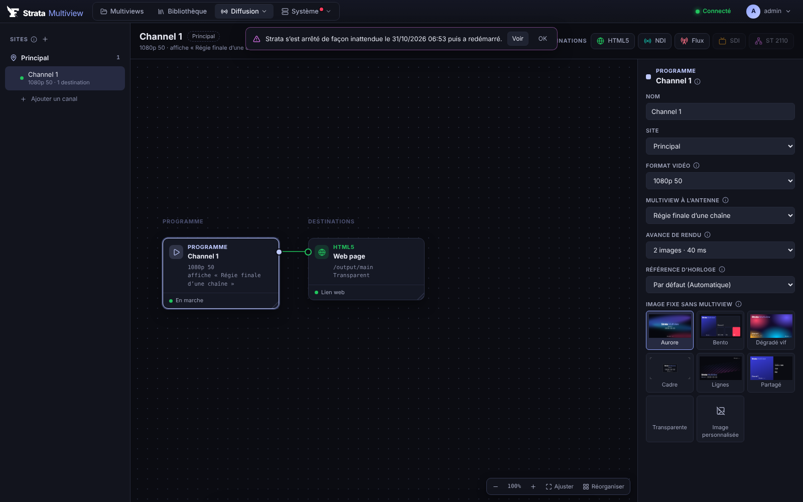

Une **chaîne** est un programme indépendant : son format vidéo, sa propre horloge, son multiview à l'antenne. Les chaînes se rangent par **site**. Chaque chaîne se règle sur un canvas : *Programme* → *Destinations*.

Le panneau de la chaîne choisit le **multiview à l'antenne** : il y passe aussitôt, et chaque publication s'y voit à l'image suivante.

| Destination | Détail |
| --- | --- |
| **HTML5** | lien `/output/<chaîne>` pour un écran, un navigateur, OBS ou vMix ; chaque entrée y arrive à la taille de sa tuile, décodée hors du fil principal et jouée régulièrement (une courte mise en mémoire absorbe l'irrégularité du réseau) |
| **NDI** | nom de source, groupes ; runtime livré avec les installateurs |
| **Stream** | SRT (appelant ou écoute), UDP (unicast, multicast), RTMP / RTMPS, HLS servi par Strata ; H.264 ou HEVC, débit, encodage matériel |
| **SDI** | carte Blackmagic DeckLink, genlock |
| **ST 2110** | flux 2110-20 4:2:2 10 bits ; multicast, TTL, SDP ; SMPTE 2022-7 sur les réseaux rouge et bleu |

Quand aucun multiview n'est chargé, la chaîne envoie une **mire**. Une **avance de rendu** d'une ou deux images garde une cadence régulière.


### 8.2 Générateur de test

Chaque chaîne a un **générateur de test** (panneau de la chaîne, Flux vidéo) : allumé, toutes ses destinations l'envoient **aussitôt** à la place du multiview, sans redémarrer les sorties (`PUT /api/channels/{id}/generator`) ; éteint, le multiview revient à l'image suivante. Pour tester une seule sortie physique, une chaîne dédiée suffit.

| | |
| --- | --- |
| **Mires** | barres **SMPTE HD** (RP 219 : barres 75 %, +I, rampe, PLUGE), barres **EBU 75 %** (100/0/75/0), barres **100 %**, **échelle de gris** et rampe, **PLUGE** (−2 %, +2 %, +4 %, références blanche et grise), **grille** et zones de sécurité (action 93 %, titre 90 %, cercle, croix centrale), **zone plate** (fréquences jusqu'à la demi-fréquence d'échantillonnage) |
| **Image** | **couleur unie**, **image fixe** de la bibliothèque |
| **Synchro son/image** | un flash au début de chaque seconde (≈ 40 ms) avec un **bip calé à l'échantillon**, un curseur qui avance d'un pas par image et le numéro de l'image dans la seconde : le décalage se lit image par image |
| **Incrustations** | identification (texte), **heure et image** (HH:MM:SS:FF), un **carré mobile** (la sortie est vivante, pas figée) |
| **Son** | tonalité **1 kHz** (ou 400 / 440 Hz) à **−18 dBFS** (EBU R68), −20 (SMPTE RP 155), −12 ou −24 ; **ident stéréo EBU** (gauche coupée 250 ms toutes les 3 s) ; **bip** chaque seconde ; silence ; ou pas de son |

Le son est fabriqué image par image, au nombre d'échantillons exact de chaque image (29,97 i/s alterne 1601 et 1602 échantillons) : il est envoyé en **NDI** et **embarqué en SDI** (DeckLink, 8 canaux, son sur 1-2, horodaté avec l'image). Les flux SRT / RTMP / HLS et ST 2110 envoient l'image seule. La page web de la chaîne montre la mire dessinée par le serveur.

### 8.2 Entrées vidéo

Les **entrées en direct** : SRT, UDP, RTMP, HLS, RTSP, toute URL lue par ffmpeg, les **directs web** (YouTube, TikTok, Twitch, Facebook, Instagram, Kick, Dailymotion, X, Vimeo, Rumble… : le simple lien du direct suffit), **NDI** (sources découvertes sur le réseau) et **SDI** (DeckLink). Chaque entrée est décodée à la taille et à la cadence de la source, avec un tampon de lissage réglable ; la page montre une vignette, l'état, les images reçues et les pertes. Une entrée qui tombe se reconnecte seule.

**Audio des entrées** (page Entrées, flux) : **piste audio** mesurée et écoutée (un flux peut porter plusieurs langues) et **ce qu'on écoute** : toute la piste réduite en stéréo, ou une paire de voies telle quelle (1-2, 3-4… d'une piste multicanal). À l'écoute (pages de sortie), **L / L R / R / M** : gauche seule, stéréo, droite seule, mono. Sur la tuile, les vu-mètres peuvent partir d'une autre voie (« À partir de la voie »), pour montrer par exemple les voies 3-4 d'une piste 8 voies.

**Sources audio Dante** (page Entrées, types *Dante / AES67* et *Carte son*) — entrées audio seules : leurs tuiles montrent vu-mètres, loudness et alarmes audio (pas d'alarme d'image) ; on les écoute comme les autres.
- **Dante / AES67 (réseau)** : les flux AES67 annoncés par SAP sont découverts sur le réseau et proposés dans une liste (appareils Dante dont le mode AES67 est activé dans Dante Controller › Device View › AES67 Config, Dante Domain Manager, tout émetteur AES67) ; ou à la main : adresse multicast, nombre de voies, L24 / L16. Reçus par ffmpeg (RTP, 48 kHz).
- **Carte son** : Dante Virtual Soundcard (ou Dante Via, ou une interface audio) installé sur le serveur, capturé par ffmpeg (ALSA / PulseAudio sous Linux, CoreAudio sous macOS, DirectShow sous Windows), avec le nombre de voies ouvertes (2 à 64). Les flux Dante natifs (non AES67) passent par ce chemin.

**Statistiques SRT** : les entrées SRT sont reçues par libsrt elle-même (chargée au démarrage, la bibliothèque qu'utilise ffmpeg ; sans elle, ffmpeg reçoit le SRT, sans statistiques). La page Entrées montre RTT, débit, pertes sur 10 s (paquets renvoyés à temps), paquets perdus pour de bon, tampon du récepteur et émetteur ; l'alarme **SRT : paquets perdus** se lève dès qu'un paquet manque à l'image (seuil par 10 s) ; le widget Graphique trace le RTT et les pertes ; Prometheus a les compteurs (`strata_srt_*`). `STRATA_SRT_NATIVE=0` revient à ffmpeg.

**Entrée de secours** (page Entrées) : une entrée peut en désigner une autre comme secours. Sans image depuis le délai réglé (2 s par défaut) et le secours vivant, ses tuiles montrent l'image, le son et les alarmes du secours, avec son nom et son tally ; l'alarme **Sur secours** se lève. Retour automatique après une image stable pendant le délai de retour (10 s ; 0 : retour à la main). Bascule manuelle depuis la page Entrées ou par `PUT /api/inputs/{id}/backup` (`{"backup": true}`, tenue jusqu'au retour manuel).

### 8.3 Contenu du signal

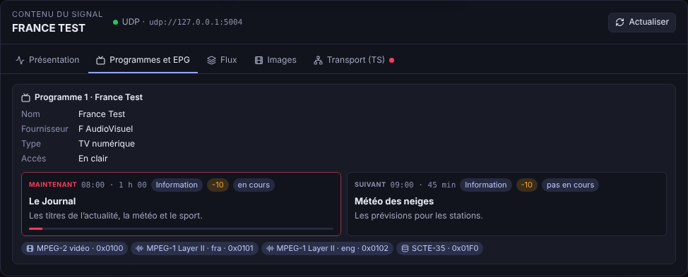

Sous les vignettes, le **contenu du signal** de l'entrée choisie, quelle que soit sa source, rafraîchi toutes les deux secondes :

| Onglet | Ce qu'on y lit |
| --- | --- |
| **Présentation** | conteneur et débit, vidéo, pistes audio, sous-titres et sous-titres codés, données, timecode, GOP, état TR 101 290, programme à l'antenne, SCTE-35, variantes HLS |
| **Programmes et EPG** | chaque programme (service) : nom, fournisseur, type, en clair ou embrouillé (systèmes d'accès conditionnel), **EPG** en cours et suivant (titre, horaire, durée, résumé, genre, âge minimum, avancement), ses flux |
| **Flux** | chaque flux et son PID : codec, profil et niveau (lus dans le SPS H.264 / HEVC), image (taille, rapport, cadence, balayage TFF/BFF/progressif, échantillonnage et profondeur, plage, couleurs, **HDR** PQ/HLG), sous-titres codés A/53, audio (fréquence, canaux, format), langue, débit, descripteurs (pages télétexte, sous-titres DVB, CEA-608/708, AC-3, audiodescription…) |
| **Images** | types I / P / B, **GOP**, balayage, format décodé, **timecode** (SEI SMPTE 12-1 ou de GOP : il alimente aussi le timecode des tuiles), CC A/53, AFD, mastering display, MaxCLL/MaxFALL, et toutes les données annexes des images |
| **Transport (TS)** | débit, TS id, réseau, heure du flux (TDT/TOT), tables vues (PAT, PMT, SDT, NIT, EIT, CAT), **TR 101 290** (priorités 1 et 2, SDT et EIT), chaque **PID** (contenu, débit, erreurs de continuité, PCR, embrouillage), **SCTE-35** (splice_insert, time_signal, segmentation, durée, sens) |
| **HLS** | liste principale et ses **variantes** (débit, résolution, cadence, codecs, plage dynamique, groupes), rendus audio / sous-titres / CC, liste de médias (direct, EVENT ou VOD, segments, fenêtre, format TS ou fMP4, program date time, discontinuités, chiffrement, LL-HLS, marqueurs publicitaires) |
| **NDI** | format, rapport d'image, balayage, timecode, audio, métadonnées XML de la source et des trames |
| **SDI** | format, signal détecté (YCbCr 4:2:2 / RGB 4:4:4, profondeur), balayage, couleurs, HDR, timecode RP 188 / VITC, audio embarqué, **paquets auxiliaires** (ANC : DID/SDID, ligne, nature : CEA-708, AFD, SCTE-104, OP-47, timecode ATC…) |

Les entrées **SRT, UDP et TCP** passent par un relais : un premier ffmpeg reçoit le flux tel quel, Strata lit son flux de transport au passage (tables, EPG, SCTE-35, TR 101 290) et le transmet au décodeur. Une entrée **HLS** est décodée dans la variante de la playlist maître la plus proche de sa taille de décodage (les autres ne sont pas téléchargées) ; une **liste de chaînes IPTV** (M3U) est reconnue et le bouton **Chaînes…** en choisit une. Un **direct web** est trouvé sur sa page par [yt-dlp](https://github.com/yt-dlp/yt-dlp), que le serveur télécharge au premier usage dans `<données>/tools` (avec [Deno](https://deno.com) pour YouTube) et tient à jour ; seule l'image et le son sont gardés, plein cadre, et l'adresse du flux, qui expire, est redemandée à chaque reprise. Quand la plateforme sert l'image et le son à part (les directs YouTube en HD), le son est lu en seconde entrée. Si ffmpeg ne peut pas ouvrir le flux trouvé (le refus d'une plateforme, une erreur TLS…), l'essai suivant le fait lire par **yt-dlp** lui-même, qui l'écrit au décodeur comme un relais (mêmes en-têtes, cookies et adresse qu'à la découverte ; analyse du transport et sous-titres compris) ; chaque échec d'ouverture passe de l'un à l'autre, et le message de l'entrée donne la cause (erreur HTTP ou TLS, message de yt-dlp). `STRATA_WEB_PIPE=1` fait passer les directs web par yt-dlp dès le départ. L'entrée HLS est analysée par ses listes de lecture et le dernier segment de sa première variante (relu à la demande, au plus toutes les 30 s). **RTMP** et **RTSP** n'ont pas de flux de transport : leur contenu vient du décodeur.

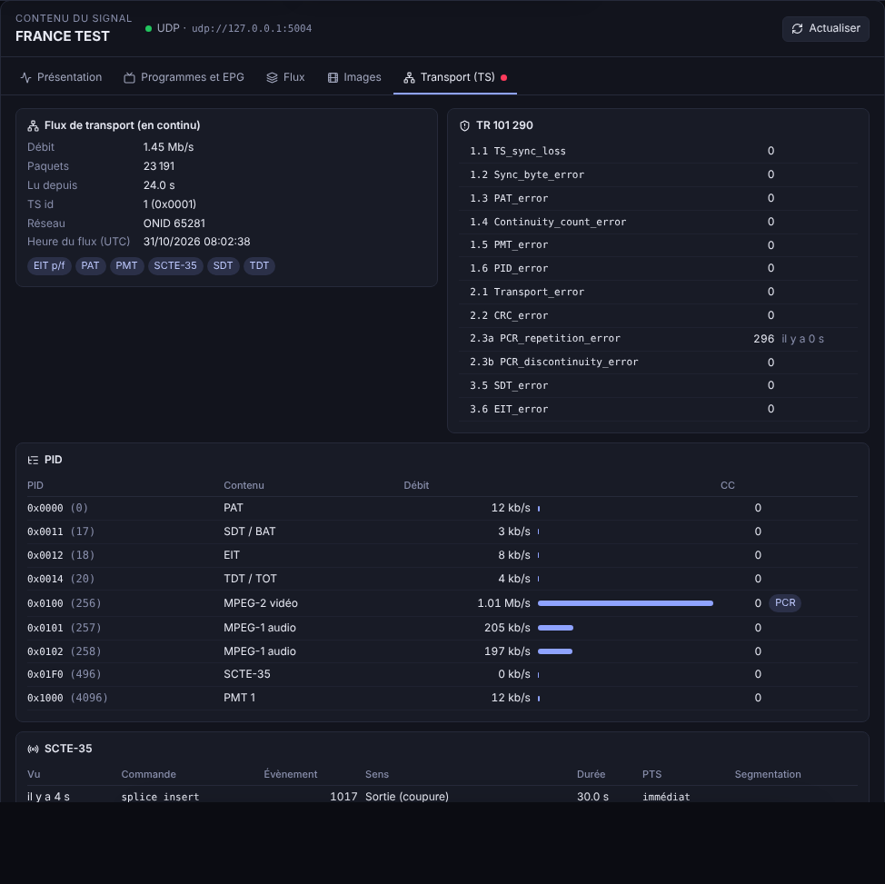

### 8.4 Matériel et synchronisation

- **SDI · DeckLink** : cartes détectées, rôle de chaque connecteur (sortie, entrée, référence).
- **SMPTE ST 2110** : flux déclarés, interfaces, PTP.
- **Rôles réseau** : contrôle, NDI, média rouge, média bleu, PTP.
- **Référence d'horloge** des chaînes : libre, PTP (grille ST 2059) ou DeckLink (genlock). Mise en place : [`docs/SYNC.md`](docs/SYNC.md).

---

### Mesure de latence

Le générateur de test en **Lip sync** envoie un flash blanc au début de chaque seconde ; Strata note quand il part. En rebouclant une sortie de la chaîne sur une entrée (par la grille, un encodeur, le réseau, un autre site…), l'entrée voit revenir le flash : la latence de toute la chaîne, décodage compris, s'affiche dans le panneau du générateur (dernière, moyenne, min–max des 20 derniers flashs), sur `GET /api/latency` et dans Prometheus (`strata_input_latency_seconds`). Essai : sortie flux H.264 en UDP rebouclée sur une entrée du même serveur, 120 à 155 ms.

### Sous-titres CEA-608 / 708

Les sous-titres codés que portent les images (ATSC A/53 : SEI des flux **H.264** et **HEVC**, user data des flux **MPEG-2**) sont lus et décodés par le serveur : **CEA-608** sur CC1 à CC4 (pop-on, roll-up, paint-on, couleurs, italique, soulignement, caractères spéciaux et accentués) et **CEA-708** sur les services 1 à 6 (fenêtres, positions, couleurs). Les images B sont remises dans l'ordre d'affichage (par PTS) avant le décodage.

- Une entrée **SRT, UDP ou TCP** est lue dans le flux de transport relayé, sans rien de plus ; une entrée **HLS, RTMP, RTSP ou fichier** reçoit de ffmpeg une copie de ses images, sans décodage, en MPEG-TS sur un port local. Le réglage **Sous-titres : Lus / Ignorés** de l'entrée (Entrées vidéo) l'arrête.
- Les canaux présents s'affichent dans les réglages de l'entrée et dans **Contenu du signal** (CC1, CC3, 708 · 1…).
- Une tuile **Source** les montre par-dessus l'image (inspecteur › **Sous-titres**) : canal (aucun, **automatique** — le premier qui en porte —, CC1 à CC4, service 1 à 6), taille et fond. Ils sont calés sur l'image affichée et dessinés de la même façon par le moteur Rust (sorties) et par la page web (Designer, sortie HTML5) : 15 rangées dans 80 % de la hauteur, la grille 608 dans le 4:3 central d'une image large, la grille 708 sur toute la zone sûre.

Un flux de test (CC1 pop-on en couleur, CC3 roll-up, service 708 n° 1) : `python3 scripts/cc-test-stream.py captions.ts 30`, à envoyer par exemple avec `ffmpeg -re -stream_loop -1 -i captions.ts -c copy -f mpegts udp://127.0.0.1:5000`. `cargo run -p strata-mv-core --example cc-dump -- fichier.ts` affiche les sous-titres d'un fichier à chaque changement.

### Murs d'écrans

Une chaîne peut être plus grande qu'un écran (3840×1080, 5760×1080, 3840×2160…) : chaque sortie (SDI, NDI, flux, ST 2110) peut n'en envoyer qu'une **partie** — moitié, quart, tiers ou zone libre (page Flux de sortie › la sortie › Mur d'écrans). La sortie prend la taille de sa partie (une sortie SDI 1080p par écran d'un mur 3840×1080), son fichier SDP et sa description NMOS aussi. Les pages web (HTML5) montrent toujours toute l'image.

### 8.5 Salvos

**Diffusion › Salvos** : plusieurs actions d'un coup — le multiview de chaque chaîne (ou son carton), le générateur de test allumé ou éteint, le secours d'une entrée, l'acquittement de toutes les alarmes. Un salvo se lance :
- d'un gros bouton de la page ;
- d'une **touche** du clavier (F1, 1, Ctrl+Maj+A…) tant que la page est affichée ;
- d'une **adresse**, pour un Stream Deck (Bitfocus Companion, action « HTTP GET ») ou un automate : `GET` ou `POST /api/salvos/{id}/run?key=smv_…` (clé d'API d'un opérateur) ;
- à **heure fixe**, certains jours ou tous les jours, dans le fuseau horaire du serveur.

Réglages dans `<données>/salvos.json` ; chaque lancement est au journal d'audit.

---

## 9. Système

- **Performances** : processeurs, mémoire, part de Strata et de ffmpeg, avertissements (rendu en retard, images perdues, entrée en défaut, horloge) ; par chaîne la cadence réelle et le temps de rendu ; par sortie ou entrée les images par seconde et les pertes ; la capacité restante de la machine.
- **Santé** : journal du serveur, arrêts inattendus, archive pour le support.
- **Utilisateurs** : comptes par rôle, accès limités à certains multiviews et à certaines chaînes. Mots de passe hachés (Argon2), session en cookie HttpOnly, clés d'API pour l'automation.
- **Paramètres** : nom du serveur, fuseau horaire, sorties publiques, réseaux, heure, synchro vidéo, sécurité, mises à jour. *Appliquer* redémarre les sorties sans redémarrer le service (le tally et les entrées continuent).
- **Sécurité** (Paramètres › Sécurité) :
  - **HTTPS** sur le port de l'interface : le certificat et la clé (PEM) indiqués, ou à défaut un certificat créé pour la machine (`<données>/tls/`, nom, nom `.local` et adresses IP), que les navigateurs demandent d'accepter une fois. Le HTTP venant d'une autre machine est redirigé vers HTTPS ; la machine elle-même reste joignable en HTTP (application de la barre des menus, scripts locaux).
  - **Annuaire LDAP / Active Directory** : un compte du serveur est essayé d'abord, puis l'annuaire (compte de recherche, filtre `(sAMAccountName={user})`, liaison avec le mot de passe saisi). Le rôle vient des groupes (`memberOf`, par nom ou DN), mis à jour à chaque connexion ; « Les autres » : rôle des personnes hors de ces groupes, ou refus.
  - **Authentification unique (OpenID Connect)** : **Okta**, Microsoft Entra ID, Google Workspace, Keycloak, Auth0 ou tout autre fournisseur OpenID Connect, préréglés dans la liste *Fournisseur*. Un bouton « Se connecter avec … » sur la page de connexion ; flux *authorization code*, client authentifié comme le fournisseur l'annonce (`client_secret_basic`, celui d'Okta, sinon `client_secret_post`), jeton d'identité vérifié (signature RS256 par les clés du fournisseur, émetteur, audience, expiration, nonce). Connexions SSO réussies ou refusées au journal d'audit. URI de redirection à déclarer : `https://<serveur>:<port>/api/auth/oidc/callback`.
  - **Okta** : Applications › *Create App Integration* › OIDC, *Web Application* ; *Sign-in redirect URI* = l'adresse ci-dessus ; affecter les groupes autorisés ; onglet *Sign On* › *Groups claim* : filtre `groups`, *Matches regex* `.*` (ou *Starts with* `mv-`). Émetteur `https://<org>.okta.com` avec le scope `groups` (préréglé), ou `https://<org>.okta.com/oauth2/default` sans ce scope, avec un claim `groups` défini sur le serveur d'autorisation. Les groupes Okta nommés dans les listes donnent le rôle (`mv-admins` → administrateur…).
  - Les secrets (mot de passe du compte LDAP, secret client) restent sur le serveur : l'interface les renvoie vides.
- **Intégrations** (Paramètres › Intégrations) :
  - **AMWA NMOS IS-04 v1.3 / IS-05 v1.1** : le serveur est un nœud de l'installation IP. Chaque sortie ST 2110 d'une chaîne est une source, un flux (`video/raw`) et un émetteur RTP (fichier SDP sur `transportfile`) ; chaque entrée UDP / RTP (MPEG-TS) est un récepteur. Enregistrement auprès d'un registre (adresse réglée, battement toutes les 5 s, ré-enregistrement s'il oublie le nœud) ; API Node sur `/x-nmos/node/v1.3/`, API Connection sur `/x-nmos/connection/v1.1/` (paramètres mis en attente et actifs, activation immédiate ou programmée, en masse, fichier SDP donné à un récepteur). Activer un émetteur change sa destination (ou le flux de Matériel qu'il suit) ou l'allume / l'éteint ; un récepteur, le groupe multicast, le port et le filtre de source de son entrée. Les identifiants (UUID) sont stables d'un démarrage à l'autre (`<données>/nmos-seed`). Les réponses suivent les schémas JSON officiels d'AMWA.
  - **Ember+** (fournisseur, port TCP 9000 par défaut, S101 + Glow) : `strata` › `info` (nom, version, durée de fonctionnement, alarmes en cours, critiques, `acknowledgeAll` pour tout acquitter), `channels` › *chaîne* › `multiview` (énumération des multiviews de la bibliothèque : le choisir le met à l'antenne), `inputs` › *entrée* › `live`, `status` (ok / warning / critical), `alarms`, `loudness` (short-term, facteur 10). Les valeurs des nœuds ouverts par le consommateur sont poussées dès qu'elles changent.
- **Journal d'audit** (Paramètres › Journal d'audit) : chaque modification faite par l'interface ou l'API (connexions réussies ou non, réglages, multiviews, chaînes, entrées, alarmes, utilisateurs, clés) avec la date, l'utilisateur, son adresse et le résultat. Fichier `<données>/audit.log` (une ligne JSON par action, 20 Mo puis `audit.1.log`), export CSV.

```bash
strata-mv-server user add <nom> [--role admin|designer|operator|viewer]
strata-mv-server user list | passwd <nom> | delete <nom>
```

---

## 10. API

La page **Système › API** documente toute l'API (OpenAPI 3.1, aussi sur `/api/openapi.json`) et gère les clés. Authentification : `Authorization: Bearer smv_…`, ou `?key=smv_…` dans l'URL pour les appareils qui ne savent pas envoyer d'en-tête.

| Méthode | Route | Rôle |
| --- | --- | --- |
| `POST` | `/api/auth/login` · `/logout` | session (cookie et jeton) ; comptes locaux puis annuaire LDAP |
| `GET` | `/api/auth/oidc/start` · `/api/auth/oidc/callback` | authentification unique OpenID Connect |
| `GET` | `/api/audit?limit=…` · `/api/audit?csv=true` | journal d'audit (admin) |
| `GET` | `/metrics` | mesures au format Prometheus (clé d'API) |
| `GET` `PATCH` `POST` | `/x-nmos/node/v1.3/…` · `/x-nmos/connection/v1.1/…` | AMWA NMOS IS-04 / IS-05 (ouvertes quand NMOS est activé) |
| `GET` `POST` `PUT` `DELETE` | `/api/projects[/{id}]` · `/export` · `/import` | multiviews (un projet de l'API est un multiview) |
| `PUT` `DELETE` `POST` | `/api/projects/{id}/templates/{tid}` · `/publish` | multiviews, publication |
| `GET` `PUT` | `/api/channels` · `/{id}/state` · `/{id}/project` · `/{id}/multiview` · `/{id}/preview.png` | chaînes, multiview à l'antenne, rendu du programme |
| `GET` `PUT` `DELETE` | `/api/tally` · `/api/tally/config` · `/api/tally/inputs/{entrée}` · `/api/tally/gpi/{source}/{contact}/{on\|off}` | tally et UMD |
| `GET` `PUT` `POST` | `/api/alarms` · `/api/alarms/settings` · `/api/alarms/ack` · `/api/alarms/journal.csv` | alarmes : réglages, journal, acquittement (`{"inputId":…,"kind":…}`, vide : toutes) |
| `GET` | `/api/inputs` · `/api/inputs/{id}/live.mjpeg` · `/api/inputs/{id}/analysis` | entrées, leurs images et ce qu'elles transportent |
| `GET` `POST` | `/api/examples` · `/api/examples/{id}` · `/api/examples/{id}/cover.png` | exemples de multiviews |
| `GET` | `/api/outputs/status` · `/api/system/metrics` · `/api/health` | supervision |
| `WS` | `/ws` · `/ws?channel={id}` | évènements temps réel (multiviews, chaînes ; signaux des entrées : niveaux, loudness, timecode, alarmes ; état PTP / NTP et journal) |

```bash
curl -X PUT http://localhost:8090/api/channels/main/multiview -H "Authorization: Bearer smv_…" \
  -H 'content-type: application/json' -d '{"templateId":"<id du multiview>"}'
```

---

## 11. Développement

Pré-requis : Rust stable et Node 22 (ffmpeg pour les tests des entrées).

```bash
# 1. Interface web (Designer, pages, sortie HTML5), embarquée ensuite dans le binaire
cd web && npm install && npm run build && cd ..

# 2. Serveur (API, WebSocket, entrées, tally, rendu, sorties)
cargo run --release -p strata-mv-server -- --data-dir data
# → http://localhost:8090/
# → http://localhost:8090/output/main
```

En développement de l'interface, `npm run dev` dans `web/` sert l'UI sur le port 5173 et relaie l'API vers le port 8090.

### 11.1 Options du serveur

| Option | Variable | Défaut |
| --- | --- | --- |
| `--bind` | `STRATA_MV_BIND` | `0.0.0.0:8090` |
| `--data-dir` | `STRATA_MV_DATA_DIR` | dossier de données de l'utilisateur ; pour le service : `/var/lib/strata-multiview`, `/Library/Application Support/Strata Multiview` ou `%ProgramData%\Strata Multiview` |
| `--web-dir` | `STRATA_MV_WEB_DIR` | UI embarquée (`web/dist` en développement) |
| | `FFMPEG_PATH` · `NDI_LIB_PATH` | ffmpeg et runtime NDI, si hors des emplacements livrés |

### 11.2 Configuration

`config.json` (dossier de données) : serveur, chaînes et leurs destinations, entrées. `tally.json` : sources de tally et aiguillage.

```json
{
  "sources": [
    { "id": "regie", "name": "Régie", "protocol": "tsl5", "transport": "udp", "port": 8901 },
    { "id": "atem", "name": "ATEM", "protocol": "atem", "host": "192.168.10.240" },
    { "id": "gpi", "name": "Boîtier GPI", "protocol": "gpi" }
  ],
  "routes": [
    { "input": "cam1", "source": "regie", "index": 1 },
    { "input": "cam2", "source": "atem", "index": 2 },
    { "input": "cam2", "source": "gpi", "index": 4, "lamp": "aux" }
  ]
}
```

### 11.3 Arborescence

```
crates/
  strata-mv-core     modèle, animation, widgets (dont la tuile Source), signaux des entrées, playout (sans I/O)
  strata-mv-render   moteur de rendu logiciel (tiny-skia, texte vectoriel)
  strata-mv-output   ST 2110-20, SDI DeckLink (image et audio embarqué), NDI (image et audio), flux
  strata-mv-server   axum : REST, WebSocket, chaînes, multiviews, entrées (audio), signaux, tally (TSL, ATEM, GPI), UI embarquée, services OS
  strata-mv-tray     app de la barre des menus / zone de notification
assets/       polices Inter (OFL) et icônes
packaging/    installateurs Linux, macOS, Windows ; ffmpeg ; NDI
web/          React + TypeScript : pages, Designer, Tally, sortie HTML5 ; i18n/ (FR / EN)
docs/         installation, architecture, synchronisation, captures d'écran
```

### 11.4 Tests et vérifications

```bash
cargo clippy --workspace --all-targets -- -D warnings
cargo test --workspace
cd web && npx tsc --noEmit -p . && npm run build
node web/scripts/i18n-check.mjs          # textes sans traduction française
```

---

## 12. Documentation complémentaire

- [`docs/INSTALL.md`](docs/INSTALL.md) : installation détaillée, dossiers, pare-feu, mises à jour.
- [`docs/ARCHITECTURE.md`](docs/ARCHITECTURE.md) : architecture du moteur et du serveur.
- [`docs/SYNC.md`](docs/SYNC.md) : synchronisation vidéo (PTP, genlock).
- [`docs/outputs.example.json`](docs/outputs.example.json) : exemple de destinations.
